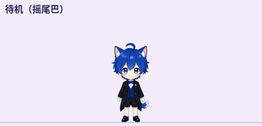
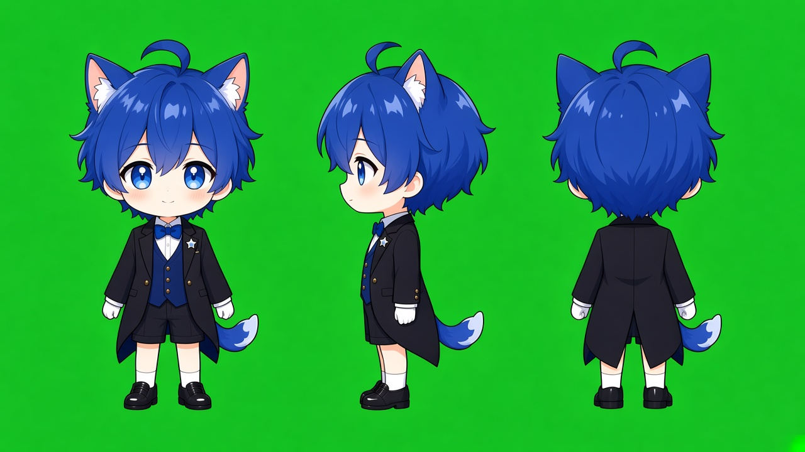
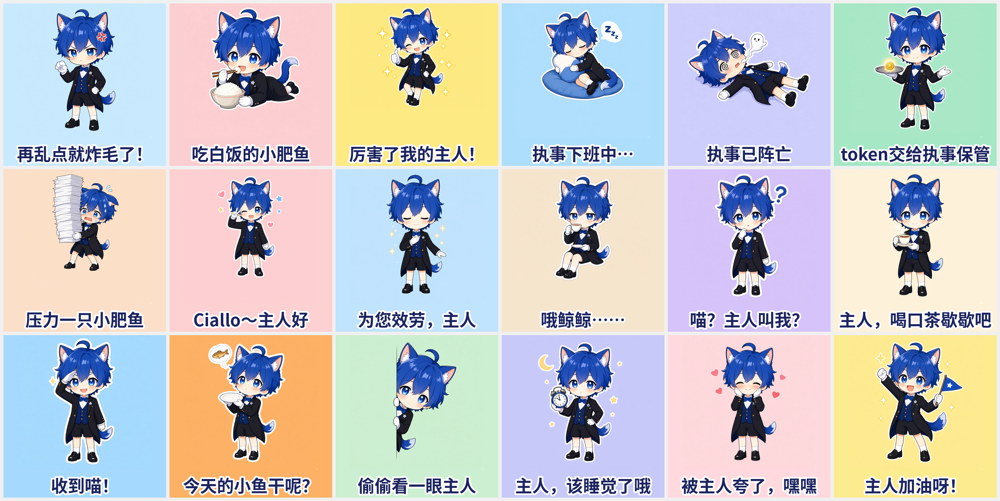

# 小肥鱼 · 猫耳执事 dsh-pet 角色包

[dsh-pet](https://github.com/PC2005-cloud/dsh-pet) 的男版角色包：蓝发猫耳的小执事「小肥鱼」，二创自「大肥鱼」形象。本仓库只包含角色包素材与配置，桌宠程序本体请前往原项目获取。







---

# 小肥鱼 v3.1 · 二头身猫耳少年执事 dsh-pet 宠物包

蓝发呆毛、蓝色猫耳、小鲸鱼尾巴的二头身 Q 版少年执事：黑色燕尾服 + 藏青马甲 + 蓝领结 + 白手套 + **白袜黑皮鞋**。
适用于 [PC2005-cloud/dsh-pet](https://github.com/PC2005-cloud/dsh-pet) 的「文件宠物」机制（`pet/<名>-config.json` 自动发现）。

## v3.1 修了什么（在 v3 基础上）

- **抠图重做**：「掸灰打扫」里鸡毛掸子、手臂和头之间围出来的那块绿底，v3 没抠掉，还被去溢色压成了一块墨绿色。v3.1 换了新的抠图方式，然后把全部 52 张动作稿都重新抠了一遍：
  - 不再只从画面边缘往里找绿色，被围住的绿底洞也会被抠掉；
  - 半透明边缘按绿色程度柔化，并做了去溢色，边上不会再泛绿；
  - 边缘再收紧 1px，零星的小碎块也一并清掉。
  - 修完后 39 段动画逐帧扫描，残留的绿色像素从每帧 100~170 个降到 0~10 个。剩下这几个只是视频压缩造成的单像素噪点，肉眼看不出来。
- **趴着等主人更顺了**：v3 是在两张差别很大的趴姿图之间来回硬切，看着会跳。v3.1 两处都只用同一张趴姿图（下巴托在手上），靠程序化的小动作让他动起来：
  - 小腿以膝盖为轴慢慢交替翘起；
  - 头和手轻轻摇；
  - 身体随呼吸起伏。
  - 「工作状态-趴着等主人」（等待档候选）也一样，而且是 5 秒无缝循环。
  - 随机动作里的「趴着等主人」从站着到趴下，中间会先下蹲一下，趴下那一刻有个轻微的压扁回弹。
- **表情包尾巴统一**：「吃白饭的小肥鱼」「执事下班中」「主人加油呀！」三张的尾巴被画成了鲸鱼尾，现在按设定稿重绘成一样的蓝色蓬松尾巴、白色尾尖。其他 15 张也检查过，尾巴和设定稿一致。「执事下班中」里的鲸鱼抱枕也换成了普通软枕，免得看着像鱼尾。

## v3 改了什么

- **主视觉统一成二头身**：先画三视图设定稿（正面 / 侧面 / 背面 3/4），所有动作都照它重画。另外按头发高度给每张动作稿做了缩放归一，所以 39 段动画里头的大小一致，不会再出现「有的动作头小身子长」。
- **去掉人耳旁边的鲸鱼鳍**：只保留头顶猫耳和身后的鲸鱼尾巴。
- **脚上换成白袜 + 黑色皮鞋**，肤色也调成更暖一点的浅蜜桃色，带腮红。
- **真·侧身走路**：画的是侧面行走循环，分 4 个姿势：迈步着地、下沉、过渡抬膝、上升。走的时候头部稳定，过渡帧最高，身体略微前倾。
  - 步幅约 90 视频像素/步，4 步 = 64 帧，正好填满宿主的匀速平移段。配置里 `minDist = maxDist = 261`，所以每次走的距离固定，脚下基本不打滑。
  - 前后各 1 秒站定，对应 `leadSec` / `tailSec`。
  - 素材原生朝左，往右走时宿主自动镜像，脸始终朝前进方向。
- **更多互动**：点击池从 3 个扩到 6 个，随机动作池加了 4 个新动作，还新增一种摇尾巴待机、第二套睡觉（坐着打盹），等待档也有了两种表现。
- **表情包**：原来 10 张全部按新设定重绘（文件名不变），另外新增 8 张，一共 18 张。
- **台词**：人设、睡觉台词、工作状态台词全部改成温柔的猫耳执事口吻：叫「主人」，常用「哦、呢、呀」，偶尔带一声「喵」。

## 包内容

```
pet/
├── xiaofeiyu-config.json      ← 宠物配置（动画池 / 人设 / 表情包清单 / 实例）
├── xiaofeiyu-animation/       ← 39 段 640×360 · 24fps · VP9 透明 webm（平铺）
├── xiaofeiyu-memes/           ← 18 张专属表情包（384×384 png）
└── xiaofeiyu-avatar.png       ← 头像
```

## 从 v3 升级到 v3.1

1. 退出 DSH。
2. 删掉 `$DSH_HOME/dsh-pet/pet/` 下的 `xiaofeiyu-animation/`、`xiaofeiyu-memes/`、`xiaofeiyu-config.json` 和 `xiaofeiyu-avatar.png`。
3. 把本包 `pet/` 里的四样东西复制进去（平铺在 pet/ 下）。动画名和 v3 完全一样，配置结构也没变。
4. 重启 DSH。

## 从 v2 升级（推荐步骤）

> DSH 数据目录默认是 `~/.dsh`（Windows：`C:\Users\<你>\.dsh`），下文记为 `$DSH_HOME`。

1. **先退出 DSH**。
2. 打开 `$DSH_HOME/dsh-pet/pet/`，**删掉**以下旧文件：
   - `xiaofeiyu-animation/` 整个文件夹。v2 的「走路踏步.webm」已改名为「侧身走路.webm」，不删的话旧文件会残留。
   - `xiaofeiyu-memes/` 整个文件夹
   - `xiaofeiyu-config.json`
   - `xiaofeiyu-avatar.png`
3. 把本包 `pet/` 里的四样东西复制进 `$DSH_HOME/dsh-pet/pet/`。注意要**平铺在 pet/ 下**，不要多套一层文件夹。
4. 内置的「蓝毛小女仆」如果 v2 时已经设成 `"display": "none"`，就不用再动。如果没设，请看下面「全新安装」的第 3 步。
5. 重启 DSH。桌面上应该只有一只新的二头身小肥鱼。
   - 如果你在设置页给小肥鱼改过人设、位置、大小，这些改动存在 `main-config.jsonc` 的用户层，会继续生效。想用 v3 的新人设，就把设置页里小肥鱼的「人设」清空。

## 全新安装

1. 把 `pet/` 里的四样东西放进 `$DSH_HOME/dsh-pet/pet/`。
2. 本包默认 `"display": "desktop"`，即只在桌面透明窗里出现。想只在 DSH 网页里出现，就改成 `"web"`。**不要用 `"both"`**，否则会画出两只。
3. 隐藏内置的蓝毛小女仆，任选一种方法：
   - 设置页 → 宠物「蓝毛小女仆」→ 显示位置选「都不显示」；
   - 或者在 `$DSH_HOME/dsh-pet/main-config.jsonc` 里写：`"pets": [{ "id": "main", "name": "蓝毛小女仆", "display": "none" }]`。
4. 重启 DSH。

## 互动与触发方式（都是宿主 dsh-pet 真实支持的触发点）

| 触发 | 播放内容 |
|---|---|
| **单击宠物**（每次从 6 个里随机抽一个） | 开心跃动 / 元气挥手 / 执事鞠躬 / **被戳吓一跳**（新）/ **摸头害羞**（新）/ **小脾气**（新：鼓脸→扭头哼一声） |
| 手机端**长按 0.5 秒** | 相当于右键，打开菜单 |
| **按住拖拽** | 被鼠标拖拽悬空反馈（以领口为支点钟摆晃动）。松手后回到待机 |
| 待机（随机） | 待机呼吸、**待机-摇尾巴**（新：尾巴快摇 + 双眨眼 + 双耳抖） |
| 随机转向 | 东张西望 |
| 随机移动 | **侧身走路**（新） |
| 随机小动作（权重 20） | 超大伸懒腰 / 哈欠连天 / 端茶侍奉 / **掸灰打扫**（新）/ **趴着等主人**（新） |
| 随机「吃什么」（权重 8） | 吃白饭 |
| 随机「小情绪」（权重 7，新分类） | **害羞捂脸** / **哼不理你** |
| 对话联动（`chatAnimationEnabled`） | 对话时模型可以挑上面任一分类动作来配合表演 |
| 右键菜单 / `/anim` | 可以点播任意一段动画 |
| 碎碎念 whisper | 碎碎念-对屏碎碎念（不规则口型），配图会从 18 张表情包里随机抽 |
| 工作状态（6 档） | 思考冒泡 / 忙碌记录 / 记录完毕 / 等待确认 / 雀跃庆祝 / 垂头叹气冒汗。「等待确认」档有两个候选：**原地张望等待** 和 **趴着等主人**，等得久时会轮换 |
| 余额（6 档） | 钱袋满溢 / 金袋叮当 / 钱袋如常 / 数金皱眉 / 袋空如洗 / 分文不剩 |
| 睡觉（右键菜单或 S 键；点一下叫醒） | 每次随机二选一：①抱鲸鱼抱枕躺着睡（开始 / 循环 / 起来）；②**坐着打盹**（新：开始 / 循环 / 起来） |

## 表情包（18 张，`xiaofeiyu-memes/`）

- 重绘的 10 张：再乱点就炸毛了 · 吃白饭的小肥鱼 · 厉害了我的主人 · 执事下班中 · 执事已阵亡 · token交给执事保管 · 压力一只小肥鱼 · Ciallo · 为您效劳 · 哦鲸鲸
- 新增的 8 张：
  - 喵？主人叫我？
  - 主人，喝口茶歇歇吧
  - 收到喵！
  - 今天的小鱼干呢？
  - 偷偷看一眼主人
  - 主人，该睡觉了哦
  - 被主人夸了，嘿嘿
  - 主人加油呀！

碎碎念配图和对话配图分别由 `whisperImageEnabled` / `chatImageEnabled` 控制。想停用某张，从 config 的 `memes` 里删掉那一行即可。

## 已知限制（宿主不支持、所以没有做的点子）

- **悬停动画**：鼠标悬停只会显示提示文字，不能播动画。
- **双击、连点升级**（比如连点 5 下就炸毛）：宿主每次单击都是独立随机抽一个，不计次数，也没有双击事件。
- **长时间没理他时的专属动画**、**按时间段切换动作**（早安 / 深夜）：宿主没有这类触发器。只能靠台词和表情包里的「该睡觉了」来提醒。
- **摸头区域判定**（点头顶和点身体反应不同）：宿主不区分点击位置，所以「摸头害羞」只是点击池里的一个随机结果。
- **吃白饭小游戏**（右键「吃白饭」，白饭从天而降、宠物跑去吃）：宿主只在网页层（`web`）给内置条目注册这个菜单。本包默认只在桌面显示，所以没有接这个玩法。
- 动作是「关键帧 + 程序化缓动」合成的，不是逐帧手绘，姿势切换处是硬切。走路的 4 个姿势两条腿共用，侧面看左右腿很像，远看是正常交替，近看第二步是第一步的重复。
- 尾巴摆动和耳朵抖动只加在正面站姿上；侧身走路时尾巴随身体起伏，没有单独摆动。
- 「趴着等主人」只靠变形让同一张图动起来，所以趴着时不会眨眼。
- 睡觉动画（躺着那套）里仍然抱着鲸鱼抱枕；表情包「执事下班中」里换成了普通软枕。
